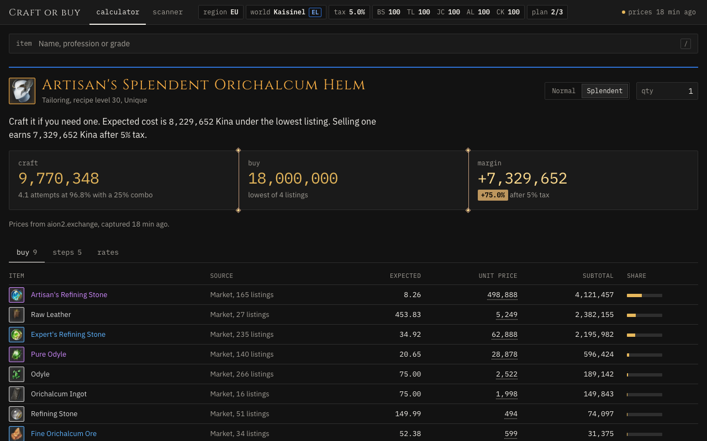

# Aion Forge

Aion Forge is a crafting cost calculator for Aion 2. It is a fork of the Grachy/aion2-craft starter and runs on your own computer. For a craftable item, it computes the expected Kina to craft it at your mastery and compares that with the item's price on the Market of one world. Recipes and success rates ship with the repository. Market prices come live from [aion2.exchange](https://aion2.exchange).

Pick an item and the page answers in one sentence whether to craft it or buy it, with three figures under it: the expected crafting cost, the lowest listing, and the margin after the Market tax. Under the crafting cost, a second line gives the cost nine runs in ten come in under, since failed attempts eat materials. Under the lowest listing, a seven-day line of it with the week's low and high shows whether the price is a trend or a one-hour blip, and clicking it opens the full chart. Three tabs hold the detail: what to buy, how each step is made, and the success rates, next to aion2.exchange's own estimate for the items it models. Click any unit price to enter your own, per world. Click a count under You have to say how many of a material you already hold; the plan uses those before it buys or crafts, and the Copy list button turns the table into plain text for a chat message. The small link after a material's name, in the buy table and under steps, opens its [AION2 Hub](https://aion2hub.com) page, which lists where it is gathered, dropped, crafted or sold. Under steps, pick buy, craft or morph for any part the plan could get more than one way; the choice holds wherever that part appears, and the row says what it costs over the cheapest way. The address bar always holds a link to the plan on screen, with its world, item, quantity, mastery, tax and plan options but none of your prices, counts or choices, and the link button at the right of the top bar copies it. The scanner ranks every recipe on your world by margin. Watch on an item's page pins it, and the pinned items' margins show in a Watching table above Best margins on the calculator home, refreshed with every price update.

To buy for a whole session at once, press Add to list on each item at the quantity you want, up to 24 per world. The list view plans them together: what you hold is spent once across all of them, bulk prices follow the total you buy, and one buy table, one Copy list text and one sentence cover the lot, with each line's quantity editable in place. A list item is never used as a material for another, since the list is what you want to end up holding. Copy link on the list view carries the list, so a Legion can open the same one.

The top bar shows the world, its side and its region. The world chip opens the world list, which you can search across all 106 worlds, with each world's current enemy world and your three most recent worlds on top. The Settings button at the right opens a drawer with your mastery per profession (100 until you change it), the Market tax, the plan options, and the prices, counts and sources you entered.



More screenshots in `docs/screenshots/`: the scanner, the world list, the settings drawer, a phone at 390 px with the world list as a bottom sheet, and a recipe with missing prices. `docs/ROADMAP.md` lists what comes next, in order.

## Run it

You need Node 24 and npm.

```sh
npm install
npm run dev
```

Open the URL that `npm run dev` prints, usually http://localhost:5173. The page starts on aion2.exchange's default world. The first visit opens the world list so you can pick yours; the world chip opens it again later.

`npm run build` type-checks and builds into `dist/`. `npm run preview` serves that build. Both `dev` and `preview` proxy `/ex` to aion2.exchange and `/a2t` to aion2t.com, because aion2.exchange sends no CORS headers. A static file server without that proxy cannot load prices. The public copy at https://aion2-craft.vercel.app gets the same two routes from the rewrites in `vercel.json`; `vercel --prod` from this directory redeploys it.

## Refresh the recipe and rate data

`src/data/recipes.json` and `src/data/rates.json` are generated and committed. To rebuild them, run the two scripts in this order:

```sh
node scripts/fetch-recipes.mjs
node scripts/fetch-rates.mjs
```

The scripts keep every download in `.cache/`, which git ignores. They fetch only the files that `.cache/` lacks, wait 200 ms between requests, and write the same output when nothing changed. To pick up a change on a source site, delete the matching file in `.cache/` and run the scripts again.

- `fetch-recipes.mjs` reads the craft, transfer (succession) and Substance Morph (conversion) recipes of both races from aion2t.com. It also reads aion2.exchange's crafting model for the 400 Kina price of the NPC-sold Bound reagents.
- `fetch-rates.mjs` reads the success and combo curves that metabot.gg publishes from the game client, one curve per recipe, indexed by level difference.

## Check the model

```sh
npm test
node scripts/verify-model.mjs
```

GitHub Actions runs the type check, the tests and the build on every pull request and on main, and main only takes a pull request whose check passed.

`npm test` runs the vitest suites for the planner in `src/domain/`, the world pairing in `src/market/`, and the verdict, search, scanner, heat, world list, status line and setup helpers in `src/state/`. `npm run check` type-checks without building.

`node scripts/validate-recipes.mjs` cross-checks every cached recipe against metabot.gg, aion2.exchange's game-file model and gamewith.ai, and fails on the first disagreement. The result table is in `docs/RESEARCH.md`.

`verify-model.mjs` needs network access. It asks aion2.exchange for its cost breakdown of every Artisan's Splendent item on server 11304, gives our planner the same unit prices at mastery 100 with crafting and morphing of materials turned off, and fails if our cost or any step's attempts differ by more than 0.5%. It also compares the gamewith.ai success tables in `.cache/gw/` with the metabot.gg curves, and the Orichalcum Ingot rate with the one aion2.exchange takes from the game files.

## How the cost is computed

For each craft step, the planner reads the success rate `p` and the combo success rate `pc` at your level difference: your mastery in the recipe's profession minus the recipe's mastery level. The level difference is capped at the end of the curve. A recipe above your mastery cannot be crafted, and the plan says so instead of guessing.

A combo fires with the recipe's combo chance `c` (25% for most equipment). It then succeeds at `pc` and gives the Splendent result.

```
Splendent results per attempt = c * pc
normal results per attempt    = (1 - c) * p
attempts                      = wanted results / results per attempt
expected material             = attempts * count per attempt
```

aion2.exchange's attempts match this: 4.1306 attempts for one Artisan's Splendent item is 1 / (0.96837 * 0.25). Transfers always succeed. A Substance Morph has the fixed rate of its recipe and makes the Bound variant of a material, which recipes accept in place of the unbound one.

Each material comes from the cheapest of three sources:

- Buy it at the lowest listing.
- Craft it from its own recipe, at your mastery.
- Morph it from Odyle.

Turning off crafting or morphing only removes that option for items that have a price. An item with no price is still crafted or morphed when a recipe exists. The normal items that a combo craft leaves behind can be credited at their lowest listing minus the Market tax.

## Where prices come from, and their limits

[aion2.exchange](https://aion2.exchange) (Aion2Market) collects the Market of every Global world once an hour and serves it read-only. The app asks for 100 items per request, asks again at most once a minute, and keeps the last quotes of each world in your browser's `localStorage`.

- The price of an item is its cheapest unit listing. For an item the plan buys in bulk, the price follows the exchange's listing ladder when the exchange has polled depth for that item. Otherwise it stays flat, so 30 units can cost more than the plan says.
- Prices are hourly snapshots, so a listing can be gone when you look in game.
- The app reads one world at a time. Prices differ a lot between worlds.
- Bound items are not on the Market. Only four NPC reagents have a known price (Orichalcum Solvent, Sandpaper, Abrasive, Catalyst, 400 Kina each). Other NPC reagents, such as Glass Bottle or Salt, have no price until you enter one.
- The 28-day sold average is empty for many items.
- No source publishes the Market tax. The default is 5%. The game shows the real rate on the Market screen.

## Credits

- [aion2.exchange](https://aion2.exchange) for Market prices and the crafting model that the verification compares against.
- [aion2t.com](https://aion2t.com) for recipes and item icons.
- [metabot.gg](https://metabot.gg/en/aion-2/crafting) for the success and combo curves from the game client.
- [gamewith.ai](https://gamewith.ai/aion2/en) for the rate tables from NCSOFT's probability disclosure, used to check the curves.
- [AION2 Hub](https://aion2hub.com) for the item pages the materials link to.

Aion 2 is a trademark of NCSOFT. This project is not affiliated with NCSOFT or with any of the sites above.
